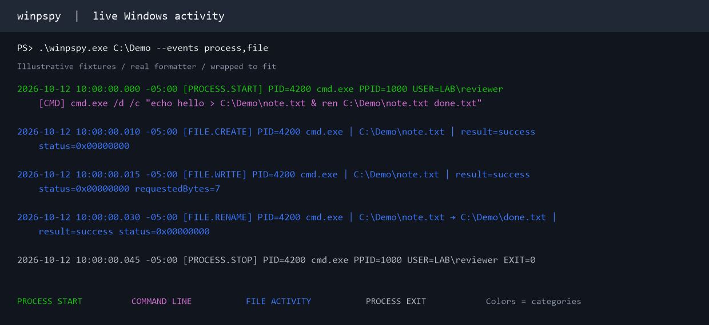

# winpspy

A live Windows activity monitor inspired by Linux [pspy](https://github.com/DominicBreuker/pspy), extending [xct/winpspy](https://github.com/xct/winpspy). You can monitor process command lines, file changes, network activity, registry mutations, services, scheduled tasks, and available PowerShell script blocks in one timeline.



Telemetry is color coded for easy viewing.

| Information | Color |
| --- | --- |
| Command lines / PowerShell script text | Magenta |
| File operations | Blue |
| Process creation / startup snapshot | Green |
| Process termination | Gray |
| Network / DNS | Cyan |
| Registry | Yellow |
| Service / task / sampled pipe activity | White |
| Collection failures / unavailable coverage | Red |

winpspy reduces console spam by grouping and summarizing activity:

- Repeated writes from the same process instance to the same path are grouped for 500 ms.
- File/network/DNS/registry console output above a combined 25 entries per second is summarized with explicit counts.
- Process and command entries are not rate-summarized. Saved JSONL retains individual collected events and reports collection losses separately.

## How to Run

Download [winpspy.exe](https://github.com/TheOriginalOrangeJuice/winpspy/releases/latest/download/winpspy.exe) for x64 Windows. 

To build from source, use .NET SDK 10.0.401:

```powershell
dotnet publish src/winpspy/winpspy.csproj -c Release -r win-x64 --self-contained true -p:PublishSingleFile=true -p:IncludeNativeLibrariesForSelfExtract=true -p:DebugType=None -p:DebugSymbols=false -p:RestoreLockedMode=true -o /tmp
```

Open an **elevated PowerShell terminal** and run `winpspy.exe`, optionally with the following flags:

```powershell
# Inspect prerequisites and check any logging configuration gaps
.\winpspy.exe --check

# Monitor all local fixed drives, plus the other default categories
.\winpspy.exe

# Choose directories to watch and save timeline events
.\winpspy.exe C:\Users D:\Data --output .\capture.jsonl

# Follow a process instance and its descendants in the console
.\winpspy.exe --pid 1234 --follow-children

# Filter the console by application and save all collected events
.\winpspy.exe --process powershell.exe --output .\session.jsonl
```

### Notes

- Ctrl+C stops collection.
- Without `--output`, winpspy does not create a capture file.

These filters affect the console, not saved captures. Exclusions also match file paths and other names.

| Option | Meaning |
| --- | --- |
| Directories to watch / `--path DIR` | File collection directories; repeatable. Default: all local fixed drives. |
| `--recursive` / `--recursive=false` | Include subdirectories (default) / direct children only. |
| `--events LIST` | Comma-separated `process,file,network,dns,registry,service,task,powershell,pipe`. Default: all except pipes. `all` also enables pipes. |
| `--pid PID[,PID]` | Console PID filter. |
| `--follow-children` | Follow the first observed selected process instances and their descendants in the console. Requires `--pid`. |
| `--process PATTERN` / `--user PATTERN` | Console image-name/full-path or account/SID filter; repeatable. |
| `--include PATTERN` | Console path/key/name filter; either rename endpoint can match. |
| `--exclude TEXT/PATTERN` | Exclude matching console entries, including command lines. Plain text matches substrings; wildcards match a full path/name, command line, or entry. Repeatable; exclusions take precedence. |
| `--contains TEXT` | Case-insensitive console text search. |
| `--output FILE` | Optional evidence file. |
| `--format jsonl\|text` | Evidence format; JSONL is the default. |
| `--raw` | Ungrouped, unthrottled console entries. |
| `--verbose` | Also collect file opens/reads and registry queries. Can generate substantial volume. |
| `--no-color` | Plain text. |
| `--duration SECONDS` | Stop automatically (maximum 7 days). |
| `--check` / `--help` | Capability report / usage. |

## Example

`PATTERN` supports wildcards: `*` matches any number of characters and `?` matches one character. Matching is case-insensitive; for example, `--process "*powershell*"`.

To hide entries containing a word, including in command lines:

```powershell
.\winpspy.exe --events process,file --exclude "Convergence"
```

Repeat a flag to select or exclude multiple applications:

```powershell
# Select Chrome, Firefox, and Edge in the console
.\winpspy.exe --process chrome.exe --process firefox.exe --process msedge.exe

# Exclude matching browser entries; * also matches full image paths
.\winpspy.exe --exclude "*chrome.exe" --exclude "*firefox.exe" --exclude "*msedge.exe"
```

## Disclaimer

Yes, AI did help make this. It works well and does its job so... yeah.
